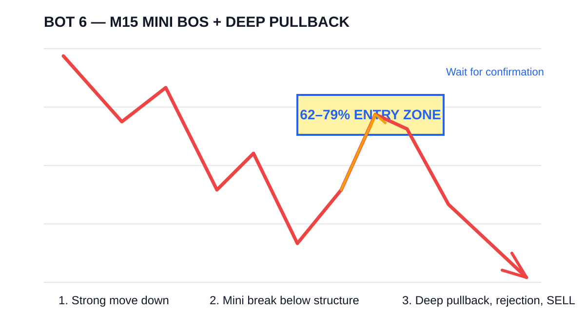

# Bot 6 — M15 mini break of structure and deep pullback

The illustration shows the SELL sequence. BUY uses the exact inverse: mini break above structure, deep pullback down into the 62–79% zone, then bullish rejection and confirmation.

Bot 6 is a selective, signal-only 15-minute continuation strategy. It does not place broker orders.

## Required entry sequence
1. H1 trend direction must agree with the trade; if H1 is unclear, no trade.
2. On M15, price must make a clear mini break of the previous five-candle micro-structure in the H1 direction.
3. Define the impulse from the recent five-candle swing extreme to the M15 breakout candle.
4. Wait for price to retrace deeply into the 62–79% pullback zone of that impulse. A touch alone is not an entry.
5. Require a separate completed M15 candle to reject the zone, close back in the trend direction, break the prior candle's high/low and close beyond EMA21.
6. Only then consider an alert. BUY logic is the exact inverse of SELL logic.

## Risk and filters
- Scans 27 major and cross pairs.
- H1 direction is mandatory; H1/M15 alignment is not required because M15 is the entry/setup timeframe.
- Stop loss is beyond the impulse-origin swing with an ATR buffer.
- Rejects unusually small or large structural risk (0.5–4.0 M15 ATR).
- Planned target is 1:1.5 reward-to-risk.
- Maximum five alerts per UTC day; one alert per pair per UTC day.
- Maximum one pending JPY-cross trade.
- Requires fresh completed M5/M15/H1 candles and a fresh live quote close to the confirmed M15 entry.
- Does not chase an entry after price has moved away.
- Every alert is logged; outcomes are resolved from later completed M5 candles. If SL and TP both touch in one candle, outcome is marked AMBIGUOUS rather than guessed. Unresolved trades expire after 24 hours.

## Data and safety
- Feed: BiQuote public FX OHLC plus its live quote endpoint; not broker-verified.
- Manual signals only. Check the broker's live price and spread before entry.
- Existing trade log and state files are retained; historical results are not reset.
- The emergency STOP kill-switch can be restored by adding `bot6/STOP`; do not do this unless you intentionally want to pause all Bot 6 scans.

## Current operating status
**Live scanner enabled.** `.github/workflows/bot6-15m.yml` runs every five minutes on weekdays and during the Sunday forex reopen window (UTC), with a manual run option. GitHub scheduling is best-effort, not guaranteed real-time. The workflow requires Actions secrets `TELEGRAM_BOT_TOKEN` and `TELEGRAM_CHAT_ID`, and persists `state.json`, `signals.csv` and evidence after each run.

## Historical validation
A separate walk-forward backtest is provided by `backtest.py` and `.github/workflows/bot6-historical-validation.yml`. It is a screening test, not proof of profitability. Public historical/live-feed outcomes may differ from executable broker prices. Use paper trading first.
